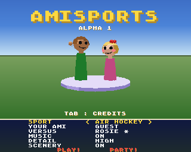
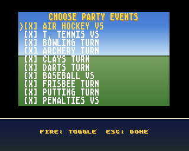
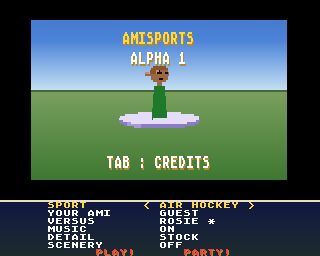

# 🕹️ BOINGBALL
### Modern software. Classic Amiga hardware.

**Original games • Multimedia applications • Sample tools • Developer libraries**

*Building software for real Amigas — from the 68000 and stock A1200 to 68060 and PiStorm systems.*

---

## ⛳ Featured release: MinTeeGolf

**[⛳ MinTeeGolf — Play 3D Crazy Golf for the Amiga →](https://boingball.itch.io/minteegolf)**

**18 holes of colourful, polygonal 3D crazy golf.** Windmills, teleporters, bumpers, tricky obstacles, AI competitors and up to four local players. Includes builds for classic 68000 machines, A1200-era systems and accelerated Amigas.

**[▶ Download / play MinTeeGolf on itch.io](https://boingball.itch.io/minteegolf)**

## 🎮 Games

| Game | Description | Link |
| --- | --- | --- |
| **MinTeeGolf** | 3D crazy golf on classic Amiga hardware; 18 holes and local multiplayer. | [itch.io](https://boingball.itch.io/minteegolf) |
| **AmiKart** | Low-poly kart racer with AI opponents, power-ups and LAN multiplayer; playable prototype. | Coming soon |
| **AmiSports** | Ten-sport Amiga party game with customisable Ami characters. **Alpha 1 is available to play!** | [Get Alpha 1 on itch.io](https://boingball.itch.io/amisports) |
| **GeoDash** | Fast-paced, rhythm-inspired arcade game. *In development.* | Coming soon |
| **The Machine** | Original Amiga game project. *In development.* | Coming soon |
| **AmiCraft** | Voxel world building and LAN adventures. *Private family project; not publicly released.* | — |

## 🏅 AmiSports — Alpha 1

**Ten sports, character creation and party play on the Amiga.** Alpha 1 is available to try on itch.io.

| Event selection | Stock A1200 presentation |
| --- | --- |
|  |  |

**[▶ Try AmiSports Alpha 1 on itch.io](https://boingball.itch.io/amisports)**

## 🎵 Mint applications

Modern-day features for classic Commodore hardware.

| Application | Highlights | Project |
| --- | --- | --- |
| **MintAMP** | MP3, AAC, FLAC, Ogg Vorbis, WMA, WAV, IFF and internet radio; GadTools and ReAction interfaces. | [Source](https://github.com/boingball/MintAMP) |
| **MintVID** | Local video playback, YouTube, IPTV and HLS streaming with ECS, AGA and RTG support. | [Source](https://github.com/boingball/MintVID) |
| **MintPRINT** | IPP network printing through the Amiga's standard printer system. | [Source](https://github.com/boingball/MintPRINT) · [Aminet](https://aminet.net/package/driver/print/MintPRINT) |
| **MintSCAN** | Network scanner utility for supported eSCL/AirScan devices. | [Source](https://github.com/boingball/MintSCAN) |
| **MintREMOTE** | Remote desktop access experimentation for classic Amiga. *Alpha.* | [Source](https://github.com/boingball/MintREMOTE) |

## 🎚️ Featured utility: WavConvert4Amiga

**A Windows sample conversion and editing toolkit built with classic Amiga audio in mind — and one I use myself when preparing sounds for my Amiga games.**

Convert WAV and MP3 sources into **8-bit mono** samples; tune for **PAL/NTSC ProTracker notes**; edit waveforms and loop points; export **WAV and IFF-8SVX**; and experiment with audio effects, recording and batch conversion queues.

**[Explore WavConvert4Amiga →](https://github.com/boingball/WavConvert4Amiga)**

## 🌐 Featured port: curl for AmigaOS

**Bringing modern curl back to classic AmigaOS.** My AmigaOS porting work makes this widely used command-line transfer tool available to the Amiga community again — another building block for modern network-capable software on vintage hardware.

I'm also credited as a contributor in curl's upstream repository. See the [upstream contributor mapping](https://github.com/curl/curl/blob/master/.mailmap) and [curl's project site](https://curl.se/).

**[Explore my Amiga curl port →](https://github.com/boingball/curl)**

## 🛠️ Engines and libraries

> Build it once, prove it in a real game, then reuse it.

| Library | Purpose | Availability |
| --- | --- | --- |
| **Ami3D** | Software polygon renderer and reusable 3D game foundations, used by MinTeeGolf and other projects. | Private development |
| **[AmiLAN](https://github.com/boingball/AmiLAN)** | Reusable C network library with non-blocking TCP/UDP, host connections, UDP discovery and optional compression. | Open source |
| **Ami2D** | Planned reusable 2D game framework following work on GeoDash. | On the drawing board |

## 🧪 Other projects

More Amiga experiments and utilities include **[Amiga Minesweeper](https://github.com/boingball/AmIgaMinesweeper)** and **[adate](https://github.com/boingball/adate)**. I also build IT, networking and PowerShell tools.

**[Browse all public repositories →](https://github.com/boingball?tab=repositories)**

---

## 💚 The idea

I develop with AI-assisted coding and a lot of real-hardware testing, profiling and iteration. The goal is useful applications and fun games that respect the limits — and exploit the strengths — of classic Amiga machines.

**Made for the Amiga community.**

[Games on itch.io](https://boingball.itch.io) · [Open-source projects](https://github.com/boingball?tab=repositories)

